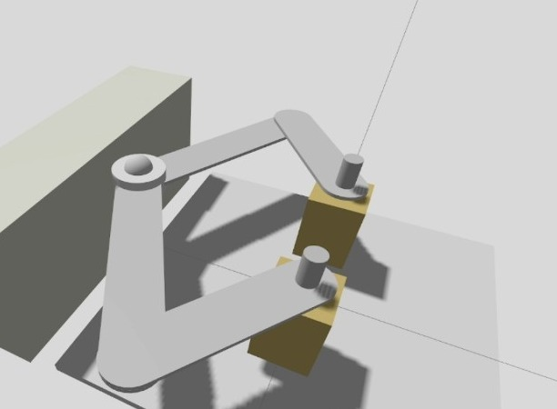
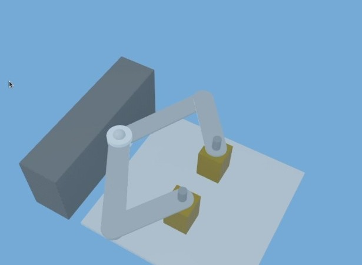
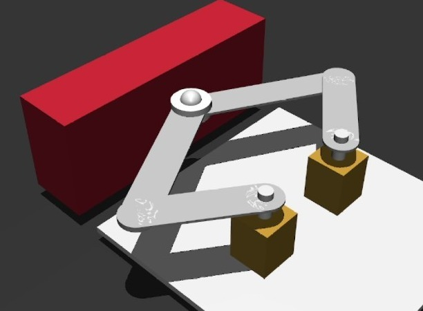
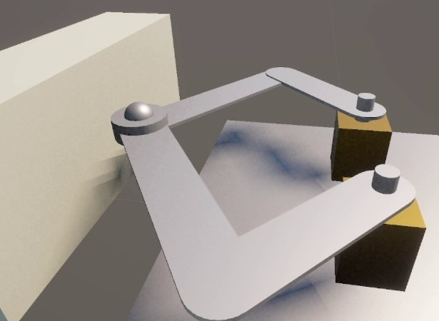
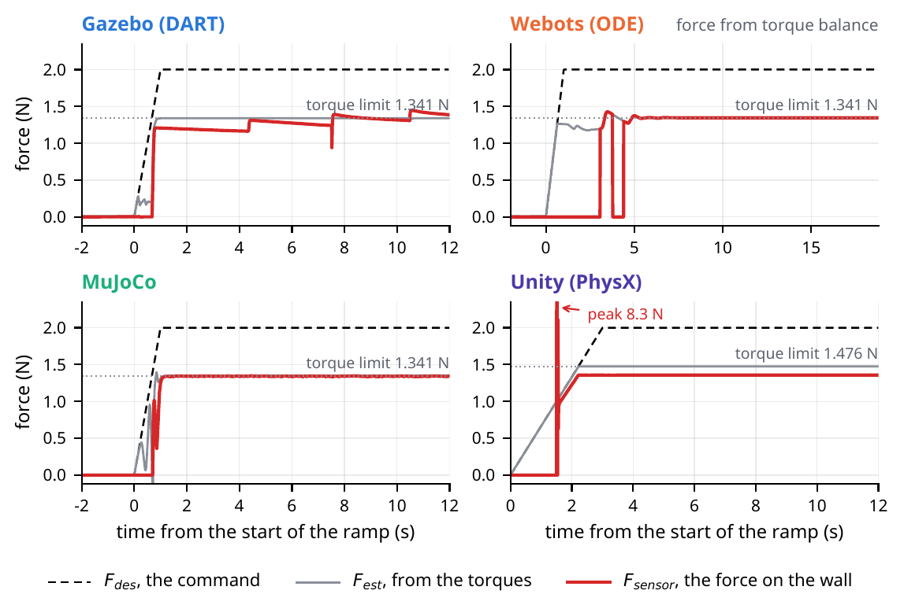

# Pantograph in four simulators

Code for my diploma thesis at the Department of Computer Science and Engineering, University of Ioannina (October 2026), supervised by Konstantinos Vlachos.

*Testing and Evaluation of Simulation Software with Application to a Pantograph*

I built the same five-bar pantograph, a closed-chain mechanism used in haptic devices, in Gazebo, Webots, MuJoCo and Unity. All four use the same kinematics and the same force controller. The experiment is simple: the tip pushes against a wall with 0.5, 1 and 2 N, and I compare the force the controller thinks it applies with the force the simulator measures at the contact.

The thesis is in Greek: [thesis (PDF)](docs/Thesis_4625.pdf), [slides (PDF)](docs/Presentation_4625.pdf).

<table>
  <tr>
    <td align="center"><br>Gazebo</td>
    <td align="center"><br>Webots</td>
  </tr>
  <tr>
    <td align="center"><br>MuJoCo</td>
    <td align="center"><br>Unity</td>
  </tr>
</table>

## Results

At 2 N the motors reach their torque limit (0.1 Nm), and in all four simulators the estimated force stops where the Jacobian says it should: 1.341 N, or 1.476 N in Unity. The force that gets to the wall is another story:

| Simulator | Force at the wall (% of the estimate) | How it's measured |
|---|---|---|
| Gazebo (DART) | 62-96% | F/T sensor. 62% at 0.5 N, 96% at 2 N |
| Webots (ODE) | 98% (at 1 N) | torque balance, the touch sensor reads 0 in R2025a |
| MuJoCo | 99% | contact force from the solver |
| Unity (PhysX) | 92% | contact impulse per step |



Dashed line is the command, grey is the estimate from the motor torques and red is the force on the wall. Same plots for [0.5 N](docs/images/fig_force_05N.png) and [1 N](docs/images/fig_force_1N.png).

MuJoCo is the closest. Unity always loses 8%, because of the way PhysX applies damping (I tested this in [unity/experiments-2026-10-02-damping](unity/experiments-2026-10-02-damping)), so it can be corrected with a calibration. Gazebo changes with the force level and jumps around, which looks like dry friction in the joints, so that one you can't really correct. For a haptic device, where the hand notices differences of about 7%, only MuJoCo is clearly good enough. And none of this shows if you just watch the simulation, you only see it when you measure the contact force.

## What's in here

- `gazebo/`, `webots/`, `mujoco/`: one ROS 2 workspace for each simulator (model, world, controller, plot script)
- `unity/PantographSim`: the Unity project. It needs `unity/ROS-TCP-Connector` to open
- `unity/pantograph_drive`: plot script for the Unity log
- `unity/experiments-2026-10-02-damping`: the damping and time step test (Section 10.4)
- `thesis/data/force`: the 12 logs of Chapter 11, and `thesis/scripts/fig_force_levels.py` makes the comparison figures from them
- `docs/`: the thesis and the slides

`Kinematics.py` is the same file in all four.

## How to run

I used Ubuntu 24.04 with ROS 2 Jazzy, Gazebo Harmonic, Webots R2025a, MuJoCo 3.13 (from pip) and Unity 6000.4.7f1, plus numpy and matplotlib. The exact versions are in Table 6.1 of the thesis.

For Gazebo, Webots and MuJoCo you need to source ROS 2 and the workspace in every terminal:

```bash
source /opt/ros/jazzy/setup.bash
source install/setup.bash
```

The force is `F_DES` at the top of each `ForceControl.py`.

### Gazebo

Needs `ros_gz_sim` and `ros_gz_bridge`.

```bash
cd gazebo/ros2_ws
colcon build --packages-select five_bar_sim --symlink-install
source install/setup.bash
ros2 launch five_bar_sim sim_torque.launch.py      # terminal 1
ros2 run five_bar_sim ForceControl.py              # terminal 2
ros2 run five_bar_sim plot_force_results.py        # when it's done
```

The log and the plot are saved in the package folder. I changed `ForceControl.py` a bit after the measurements (500 Hz, friction compensation also at standstill, stiffer y axis). The Chapter 11 numbers were taken with the gains of Table 5.2.

### Webots

Needs `webots_ros2_driver`.

```bash
cd webots/webots_ws
colcon build --packages-select pantograph_pkg --symlink-install
source install/setup.bash
ros2 launch pantograph_pkg pantograph_force.launch.py
ros2 run pantograph_pkg plot_results               # when it's done
```

The launch file opens Webots, the bridge and the controller. If Webots is already open with this world, it connects to that one instead. Don't open Webots from the snap menu, the bridge can't connect to it (the launch file prints the right command). If it hangs, check that no old Webots process is still using port 1234. The log goes to `src/pantograph_pkg/webots_force_log.csv`.

### MuJoCo

```bash
pip install mujoco numpy matplotlib                # on 24.04 add --break-system-packages
cd mujoco/mujoco_ws
colcon build --packages-select pantograph_bot --symlink-install
source install/setup.bash
ros2 run pantograph_bot sim_torque                 # terminal 1
ros2 run pantograph_bot controller_force           # terminal 2
ros2 run pantograph_bot plot_force_results         # when it's done
```

The simulation stays paused until the controller sends its first command. Closing the viewer stops it.

### Unity

Open `unity/PantographSim` from Unity Hub. The first time takes a while, because Unity rebuilds the Library folder and downloads the URDF Importer from GitHub. The scene (`SampleScene`) already has the mechanism and the wall. Enable `PantographForceControl` on `five_bar_mechanism`, set `Target Force N` and press Play. The control starts after 3 s and the log is written to `unity/PantographSim/unity_force_log.csv`. To plot it:

```bash
python3 unity/pantograph_drive/plot_unity_force.py
```

You only need the `Tools > Pantograph` menu if you import the URDF again. In that case run `Setup Five-Bar` and then `Add Contact Wall`, with the simulation stopped.

### Thesis figures

```bash
cd thesis
python3 scripts/fig_force_levels.py
```

This makes the three comparison figures from `thesis/data/force`. The labels are in English now, so they're not exactly like the ones in the PDF.

## Original version

The tag `v1.0-submitted` has the code exactly as I handed it in, with the Greek comments and the paths that expect the folder at `~/Desktop/pantograph` (that's what Appendix A of the thesis uses).

## License

The code is under Apache-2.0, like the ROS 2 packages. The thesis and the slides in `docs/` are not covered by it. `unity/ROS-TCP-Connector` is from Unity Technologies, also Apache-2.0.

## Ελληνικά

Η εργασία είναι στα ελληνικά, στο [docs/Thesis_4625.pdf](docs/Thesis_4625.pdf). Οι εντολές του Παραρτήματος Α δουλεύουν, απλά πλέον ο φάκελος μπορεί να είναι οπουδήποτε και το log του Webots γράφεται στο `webots/webots_ws/src/pantograph_pkg/`. Τον κώδικα όπως τον παρέδωσα, με τα ελληνικά σχόλια, τον βρίσκεις στο tag `v1.0-submitted`.
